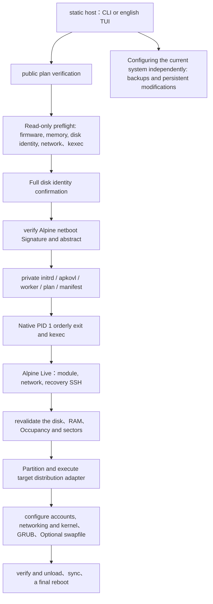

# project architecture

the project is bin456789/reinstall of individuals Linux x86_64 Derivative version, reserved GPLv3。It is currently a development preview with real liquidation capabilities, and the full installation acceptance has not yet been completed. new agent Read first [Continuation Guide](AGENT-HANDOFF.md)，Run the evidence with [ACCEPTANCE.md](ACCEPTANCE.md) Subject to。

## Table of Contents and Responsibilities

```text
rustaller/
├── Cargo.toml / Cargo.lock / rust-toolchain.toml
├── build.rs                  Matches provided by the embed builder worker
├── src/
│   ├── lib.rs                Core entrance, centralized statement host/worker/shared/targets submodule
│   ├── bin/rustaller.rs      CLI/TUI Entry, inspection, confirmation and execution
│   ├── bin/rustaller-worker.rs
│   │                         No interface Live、Network, first boot and log commands
│   ├── model.rs / config.rs / postinstall.rs
│   │                         Installation plan and configuration model; do not perform installation directly
│   ├── codec.rs / plan_file.rs / deployment.rs
│   │                         Bounded encoding, private plan file, disk/Network deployment checklist
│   ├── command.rs / fsutil.rs
│   │                         child process、mock、swap protection and shared Live Command defaults, atomic writes
│   ├── host/                 args、preflight、disk、sources、handoff、
│   │                         initrd、boot、iso、current、ssh_keygen
│   ├── worker/               args、live、install、initrd_network、firstboot、log_stream
│   ├── targets/              packages package policy；install public installation；debian / rolling adaptation
│   ├── shared/               storage、configure、dns、network、swapfile
│   └── tui/                  host Exclusive directory status, fields, editing, rendering and testing
├── xtask/src/                check、bundle、dist、sources、vm、vm_guest
├── tests/                    Rust isolated tests；verify/ for alone Shell Match shooting crate
├── .github/workflows/        Check and Preview Release draft
└── docs/                     Current interface, architecture, acceptance, continuation and historical description
```

Modules are divided according to responsibilities, and the public path remains stable；TUI of mod.rs Contains interface logic。

## Run process



Alpine Latest stable version、Debian stable/minbase、Arch rolling、Gentoo systemd stage3 All from Alpine Live Installation, relying on the distribution’s native tools。CLI/TUI Share models and callbacks, save drafts by target；ssh-keygen Temporarily restore the terminal and only the public key enters the program. The current system configuration is independent of liquidation, see [CONFIGURATION.md](CONFIGURATION.md)。

## module boundaries

| layer | Responsible | irresponsible |
|---|---|---|
| model/config/postinstall | Plan, field and combination constraints | File modification, download, and installation execution |
| host | Discovery, authentication resources, identity confirmation, handover, current system configuration | Format the target disk directly in the original system |
| worker | Live Entrance and stage sequence, first start service | TUI、Ask again for host installation options |
| targets | Each release rootfs、package, kernel、GRUB、verify | UI、Arbitrary user script hook |
| shared | Configuration and storage operations in the inspected target directory | Authorization to select target disk |
| command | clear argv/env/I/O、concurrent capture、mock、swap limitation | Interpret and execute freely entered Shell |
| xtask | Development inspection, static packaging, source audit, isolation VM | deploy with the runtime |

Live Command default cwd=/、stdin=null、Output inheritance; adapters retain their own environment and errors/retry semantics。

## Merge of similar code（2026-11-12）

This reconstruction passed 278 items workspace、49 items Shell Tests and formats/lint/syntax check, static bundle、worker Precisely embedded with two entrances --help Check passed; no new additions BIOS/UEFI Complete proof of installation。

| public entrance | Combined responsibilities | The caller remains responsible |
|---|---|---|
| command::checked_output | Start command, require exit code zero, construct unified command error | stage name、argv、environment, working directory and I/O Strategy |
| command::run_checked / capture_checked | Execute and inspect and capture separately stdout And check; reuse the same status check | UTF-8 Decoding, field errors, and output length limitations |
| command::target_command | Common to both sets of target adapters Live default value、PATH and SYSTEMD_OFFLINE | install of LC_ALL/DEBIAN_FRONTEND；rolling of LANG/TERM |
| shared::dns::write_config | Check the target path, prepare the parent directory, and write atomically according to the specified permissions | Target root Isolation verification, configuration content, target distribution and permission selection |
| shared::dns::walk_parents | Check whether the ancestors at each level are real directories; decide whether to create missing directories based on the entry | validate_planned_parent keep checking only，ensure_parent Allow creation |

host/handoff、worker/install、targets/install、targets/rolling、shared/swapfile share capture_checked；Output upper limit, decoding error and stderr The policy remains on the caller。worker/install Reuse live_command and retain LC_ALL=C。

target write multiplexing dns Path check, no new cross-layer modules; batch DNS/The network still verifies the entire batch before publishing, maintaining the modification range before the failure.。

Different implementations that preserve semantics: three UUID check、Gentoo Metadata parsing and signature authentication、Debian/public fstab Comments/ESP/fsck difference. Disk, memory, and mount rechecks are security checks and are not deleted as duplicate codes.。

## Principle of action and reading order

1. bin/rustaller.rs：CLI/TUI share InstallPlan with callbacks；model/config/postinstall Define configuration，codec/plan_file Responsible for handover and private file life cycle。
2. host/handoff.rs：discover Collect legacy system facts and disk tokens，prepare Certification resources/Assemble Live，execute After re-inspection, PID 1 orderly exit and kexec，No firmware restart。
3. bin/rustaller-worker.rs、worker/install.rs：verify Live Source, recovery network/SSH，by manifest Stable identity, rebind the disk, and re-verify RAM/mount/swap/partition after sector。Live The root is in memory and the target is mounted on /os。
4. targets/install.rs、debian/rolling/packages：series connection prepare/bootstrap/configure/Final verification, with native APK、APT、pacman、Portage Implement release differences；Rust Control parameters and sequence。
5. shared：storage layout/format/Mount, the remaining modules configure the inspected target. Verification successful, uninstall、sync Only then finally restarted, failed to retain Live Restoration environment。
6. host/current.rs：Independent backup/Publish current system configuration；TUI Responsible for drafts and presentations。xtask、test、Shell Matchmaking as a development tool，Rust Automatic entry does not call reservation Shell accomplish。

## indestructible constraints

- The core has no third-party runtime dependencies；ratatui/crossterm only host Optional tui feature。worker use --no-default-features。
- plan schema=6；deployment manifest schema=1；Compatibility mark RUSTALLER-CONFIG-20261112-06。Reject the old plan; changes to the handover agreement must be verified and tested simultaneously。
- Alpine netboot and Gentoo stage3 Have a fixed publishing key/sign/digest verification；APT/APK/pacman Use native trust chain。audit-sources Only check metadata and reachability。
- Liquidation is based on stable disk identity，Live verify the mount after rebinding、swap、RAM and readonly/sector status。
- UEFI Require 64 Bit firmware and not enabled Secure Boot；512 MiB FAT32 ESP；GRUB use removable/no-nvram。Please see the acceptance document for platform restrictions.。
- Root file system optional XFS（default）/ext4，format、fstab、initramfs and GRUB Verification is configured according to the selection; the original system and Live Not executed swapon/swapoff，Target /swapfile Activate only on boot。
- non- root installed root Passwords are individually masked, confirmed and handed over privately；CLI In the interactive terminal, you can be prompted to complete the，root SSH remain disabled。hostname Detect and write the plan on the original system, use the release name if missing。
- DNS preset/Customize to submit only selected values。Arch CachyOS Use fixed official scripts with keys、OS Available ISA Detection and complete update of the target on first boot; other kernels will not be introduced into this warehouse。
- Failure does not require a final restart; it cannot automatically fall back to two restarts. Currently only suitable for systemd/openrc-init original system PID 1。

## Build and distribute

`cargo xtask bundle` verify absence of TUI worker of static ELF/version, then embed host and check the exact bytes。`cargo xtask dist` reject dirty source by default，Release Keep draft/prerelease、`installer_complete=false`；CI Get the fixed upstream matching object. See[Publishing Guidelines](GITHUB-RELEASE.md)。

## reserved Shell baseline

Shell The compatibility flag remains PERSONAL-LINUX-ONLY-20261119-04；Rust new tags and schema Not used for these reserved resources。

`reinstall.sh` Prepare original system，`trans.sh` implement Live Installation; reserved for comparison and unmigrated interfaces, cannot be deleted before acceptance, and cannot be mixed. Rust/Shell Confirmation and resource model。

Shell deployment except reinstall.sh There are still exactly four resources outside：trans.sh、initrd-network.sh、fix-eth-name.sh、logviewer.html。TTY/frpc helpers and service templates are inlined; the resource must come from a user-controlled match HTTPS deployment。Rust Embedded worker and log page, do not apply this four-file deployment rule。

Rust Manual ISO/netboot.xyz/reset There is currently a menu/Model/components only; execution handoff is not connected. Retained code does not constitute a delivered feature; see the handoff guide。

## Standalone native management component

`tools/dmitbox-local` Keep modular development, single file Bash Distribution and independent transaction status。`xtask::local_tool` use Rust Complete the warehouse-level construction and check entry, and the generated bytes are consistent with the original component construction results. installer、Live worker、Four items Shell None of the runtime assets automatically call the tool; its full distribution/Separate record of network acceptance。
