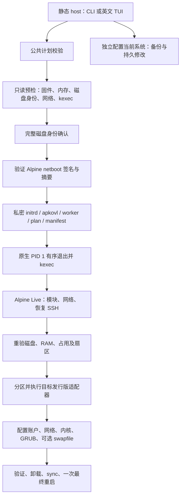

# 项目架构

项目是 bin456789/reinstall 的个人 Linux x86_64 衍生版，保留 GPLv3。当前为有真实清盘能力的开发预览，完整安装验收未完成。新 agent 先读 [续接指南](AGENT-HANDOFF.md)，运行证据以 [ACCEPTANCE.md](ACCEPTANCE.md) 为准。

## 目录与职责

```text
rustaller/
├── Cargo.toml / Cargo.lock / rust-toolchain.toml
├── build.rs                  嵌入构建器提供的匹配 worker
├── src/
│   ├── lib.rs                核心入口，集中声明 host/worker/shared/targets 子模块
│   ├── bin/rustaller.rs      CLI/TUI 入口、检查、确认与执行
│   ├── bin/rustaller-worker.rs
│   │                         无界面 Live、网络、首启与日志命令
│   ├── model.rs / config.rs / postinstall.rs
│   │                         安装计划及配置模型；不直接执行安装
│   ├── codec.rs / plan_file.rs / deployment.rs
│   │                         有界编码、私密计划文件、磁盘/网络部署清单
│   ├── command.rs / fsutil.rs
│   │                         子进程、mock、swap 防护、公共 Live 命令默认值、原子写入
│   ├── host/                 args、preflight、disk、sources、handoff、
│   │                         initrd、boot、iso、current、ssh_keygen
│   ├── worker/               args、live、install、initrd_network、firstboot、log_stream
│   ├── targets/              packages 包策略；install 公共安装；debian / rolling 适配
│   ├── shared/               storage、configure、dns、network、swapfile
│   └── tui/                  host 专属目录状态、字段、编辑、渲染与测试
├── xtask/src/                check、bundle、dist、sources、vm、vm_guest
├── tests/                    Rust 隔离测试；verify/ 为单独 Shell 对拍 crate
├── .github/workflows/        检查与预览 Release 草稿
└── docs/                     当前接口、架构、验收、续接与历史说明
```

删除了四个仅含模块声明的 mod.rs，原有公开 Rust 模块路径不变。TUI 的 mod.rs 包含实际逻辑，继续保留。没有为了减少文件而合并安装调度、存储操作和用户界面。

## 运行流程



自动目标为 Alpine 最新 stable、Debian 最新 stable/minbase、Arch rolling、Gentoo systemd stage3。四者都在 Alpine Live 安装。运行时依赖发行版原生包管理器和系统工具；静态 Rust 入口不是一个内含全部发行版的镜像。

CLI 和 TUI 共用模型与安装回调；TUI 不重复安装流程。多级目录先选系统，按目标保存草稿，返回支持 Save/Discard/Cancel。原生 ssh-keygen 会暂时恢复终端，仅公钥进入计划。当前系统配置独立于清盘流程，详细边界见 [CONFIGURATION.md](CONFIGURATION.md)。

## 模块边界

| 层 | 负责 | 不负责 |
|---|---|---|
| model/config/postinstall | 计划、字段及组合约束 | 文件修改、下载、执行安装 |
| host | 发现、认证资源、身份确认、交接、当前系统配置 | 在原系统直接格式化目标盘 |
| worker | Live 入口与阶段顺序、首启服务 | TUI、再次询问主机安装选项 |
| targets | 各发行版 rootfs、包、内核、GRUB、验证 | UI、任意用户脚本钩子 |
| shared | 受检目标目录中的配置及存储操作 | 授权选择目标盘 |
| command | 明确 argv/env/I/O、并发捕获、mock、swap 限制 | 解释并执行自由输入的 Shell |
| xtask | 开发检查、静态打包、源审计、隔离 VM | 随运行时部署 |

公共 Live 命令默认 cwd=/、stdin=null、输出继承；targets 仍保留各自 locale、PATH、非交互环境及错误/重试语义，避免“合并”改变原生工具行为。

## 不可破坏的约束

- 核心无第三方运行时依赖；ratatui/crossterm 仅 host 可选 tui feature。worker 用 --no-default-features。
- 计划 schema=5；部署清单 schema=1；兼容标记 PERSONAL-LINUX-XFS-20261102-05。改变交接协议必须同步校验与测试。
- Alpine netboot 与 Gentoo stage3 有固定发布密钥/签名/摘要验证；APT/APK/pacman 使用原生信任链。audit-sources 只检查元数据和可达性。
- 清盘以稳定磁盘身份为依据，Live 重绑后再验挂载、swap、RAM 和只读/扇区状态。
- UEFI 要求 64 位固件与未启用 Secure Boot；512 MiB FAT32 ESP；GRUB 使用 removable/no-nvram。平台限制见验收文档。
- 原系统和 Live 不执行 swapon/swapoff；可选新目标 XFS /swapfile 仅在目标启动后激活。
- 失败不请求最终重启；不能自动退回两次重启。当前只适配 systemd/openrc-init 原系统 PID 1。

## 构建与分发

cargo xtask bundle 先构建无 TUI worker，验证静态 ELF 与版本，再嵌入 host 并验证匹配字节。cargo xtask dist 默认拒绝脏源码；GitHub Release 继续为 draft/prerelease，installer_complete=false。源码复制到新仓库后，CI 会获取固定上游对拍对象，无需把整个上游历史装入源码包。见 [发布指南](GITHUB-RELEASE.md)。

## 保留的 Shell 基线

Shell 兼容标记仍为 PERSONAL-LINUX-ONLY-20261119-04；Rust 的新标记和 schema 不用于这些保留资源。

reinstall.sh 是原系统准备入口，trans.sh 是 Live 安装脚本；Rust 与 Shell 是两条实现，不能混用各自的授权与资源模型。Shell 留作对拍及尚未迁移接口，不能在 Rust 完整验收前删除。

Shell 部署除 reinstall.sh 外仍恰好四个资源：trans.sh、initrd-network.sh、fix-eth-name.sh、logviewer.html。TTY/frpc helpers 和服务模板已内联；资源必须来自用户控制的匹配 HTTPS 部署。Rust 内嵌 worker 与日志页面，不套用这条四文件部署规则。

Rust 手动 ISO/netboot.xyz/reset 目前有菜单/模型/部分组件，实际交接未连接。保留代码不等于功能已交付；完整待办见续接指南。
