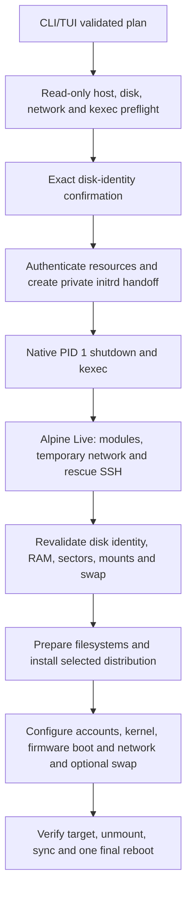

# Architecture

Rustaller is a Linux x86_64 reinstallation tool. One Rust workspace contains the
primary crate and `xtask`. The `rustaller` host executable embeds the exact
matching `rustaller-worker`; the optional `tui` feature belongs to the host.
There is no current-system administration mode or separate recovery executable.

```text
src/
├── bin/                 host CLI/TUI and internal worker entry points
├── model.rs, config.rs  typed InstallPlan and target configuration policy
├── postinstall.rs       kernel, hostname and timezone validation
├── codec.rs, plan_file.rs, deployment.rs
│                        bounded private plan, disk identity and network facts
├── command.rs, fsutil.rs typed native commands and safe per-file replacement
├── host/                preflight, sources, disk/network discovery and kexec
├── worker/              Alpine Live execution, temporary networking and first boot
├── targets/             Alpine/Debian/Arch/Gentoo packages, kernels and boot generation maintenance
├── shared/              target storage, configuration, networking and swapfile
└── tui/                 installation drafts, editing and review
xtask/src/               checks, bundle, preview release, source audit and VM harness
tests/                   isolated Rust integration tests and fixtures
```

## Lifecycle



`host` observes the original machine and prepares the handoff; it does not
partition its disks directly. Source PID 1 must be systemd or openrc-init.
The host selects a verified Ethernet owner per link or uses an explicit
MAC-bound plan. NetworkManager, networkd, ifupdown and dhcpcd adapters keep
manager evidence separate from observed addresses and routes. The resulting
manifest supplies Live and native target configuration. Kexec is required.
`worker` admits only the private Alpine Live environment and binds the selected
disk to its stable recorded identity before destructive actions. The target is
mounted separately, normally at `/os`. The host lifecycle record locks staged
preparation and handoff transitions. In Live, a separate RAM record arbitrates
cancellation and the first destructive disk operation.

Offline `rustaller --inspect` collects local facts without making an install
plan or exposing disk identity tokens. Optional procfs, sysfs and bounded
command probes may report unavailable data. The report groups system load,
CPU/ISA, kernel security, memory and NUMA, storage, network observations and
firmware. Default output redacts stable device identifiers and sensitive
kernel arguments. The TUI uses the same cached report. [Inspection reference](https://github.com/su-haris/simple-network-speedtest/blob/master/speed.sh)

`targets` owns native distribution bootstrap, package trust, accounts, kernel
payloads, initramfs and boot configuration. Debian uses debootstrap minbase and systemd;
Alpine uses OpenRC; Arch uses systemd. Gentoo uses a selected OpenRC (new-plan
default) or systemd amd64 no-multilib stage3 and a matching Portage profile.
The release builds rustaller-boot for UEFI and BIOS. FAT32 is mounted at `/boot`;
native kernel/initramfs files and immutable Rustaller generations share that
filesystem. BIOS normally uses MBR with
FAT32 + root; UEFI uses GPT with ESP + root. BIOS disks at least 2 TiB use GPT
with a dedicated stage2 partition followed by FAT32 + root. Root can be XFS,
ext4 or Btrfs (`@`, optional zstd).

`shared/storage.rs` owns explicit numbered partition roles and pure layout/fstab
rendering. `boot/core` owns the bounded TOML schema and Linux command line.
`boot/uefi` and `boot/bios` provide the firmware entry points. Linux-side
`targets/bios.rs` verifies raw embedding extents. `targets/boot.rs` installs
release-built artifacts and maintains generations through the static
`rustaller-boot-update` helper. [Boot configuration and recovery](BOOT.md)

Refresh scans only flat native `/boot` files, matches each kernel with its
distribution-specific initramfs name, and stages complete ordinary-file copies
in a unique generation directory. It checks the recorded FAT UUID, holds a
Linux-root advisory lock, checks capacity, syncs all payloads, validates every
configuration reference, and then publishes `rustaller/boot.toml`. A self-contained
previous configuration and its generation remain available, including previous
entries in the active menu. FAT rename/sync cannot promise journaled-filesystem
power-loss atomicity; recovery can restore the validated previous configuration.
Root Btrfs snapshots do not include `/boot` or restore matching boot artifacts.

`host/inspect.rs` collects typed optional system, memory, virtualization, storage,
firmware and network facts independently of installation authorization.
`host/inspect_cpu.rs` isolates CPU topology and psABI classification. CLI/TUI
inspection uses offline inventory; it does not fetch source metadata. Failed
installation compatibility leaves optional facts visible and blocks execution.
The TUI renders cached facts, planned values and explicit unknowns without probing
inside its render loop. Host firmware is authoritative; forced mode is an
assertion and cannot switch it.

## CPU capability methodology

Inspection reports guest-visible capabilities without changing the generic target
ISA baseline. A dedicated probe thread inherits the caller's affinity, pins itself
to each allowed logical CPU, reads guarded CPUID leaves, and intersects their
capabilities. It restores affinity before exiting; an incomplete scan or failed
state check reports Unknown. CPU names never determine ISA support.

Classification follows the cumulative
[x86-64 psABI levels](https://gitlab.com/x86-psABIs/x86-64-ABI/-/raw/master/x86-64-ABI/low-level-sys-info.tex)
and [GCC x86 options](https://gcc.gnu.org/onlinedocs/gcc/x86-Options.html).
The baseline requires long mode, FPU, CMOV, CMPXCHG8B, FXSR, MMX, SSE/SSE2
and syscall support, with OSFXSR/SCE supplied by the running Linux x86-64 ABI. v2 additionally
requires CMPXCHG16B, LAHF/SAHF, POPCNT, SSE3, SSSE3, SSE4.1 and SSE4.2.
v3 additionally requires AVX, AVX2, BMI1, BMI2, F16C, FMA, LZCNT and MOVBE,
plus XSAVE/OSXSAVE and OS-enabled XMM/YMM state: guarded XGETBV(0) must satisfy
`XCR0 & 0x6 == 0x6`. v4 additionally requires AVX512F/BW/CD/DQ/VL and enabled
opmask/ZMM state: `XCR0 & 0xe6 == 0xe6`. AES-NI and VMX/SVM are separate facts.
Hypervisor masking and heterogeneous CPUs can lower the common usable level;
missing procfs fields or unavailable affinity/OS-state checks never raise it.

## Configuration boundaries

`InstallPlan` holds credentials and typed `SystemConfig`/`PostInstallConfig`.
`DeploymentManifest` separately records disk identity and validated source
network facts. Handoff encoding is bounded and rejects incompatible versions.
Plan schema 11 includes optional explicit Ethernet policy. Schema 10 is
migrated in memory with the stored profile and init fields intact. The
embedded worker matches the host runtime, and older incompatible plan bodies
are rejected.

- `host/network.rs`: observe source addresses, applied policy and supported routing;
  `host/handoff.rs` retains authenticated installation preparation and kexec.
- `worker/initrd_network.rs`: restore connectivity in temporary Alpine Live.
- `shared/network.rs`: pure final target rendering, kernel prerequisites, and
  publication of native interface/DNS/MTU/TCP/module/GAI configuration.
- `shared/configure.rs`: target isolation, safe bounded reads, complete output
  validation, publication, hostname/timezone and offline service links.
- `fsutil.rs`: exclusive temporary files, sync, rename and failure cleanup.

Package operations use bootstrap DNS. Final network publication happens after
those operations. Replacements are atomic per file, not across the batch;
installation failure retains Live and prevents the final reboot.

## First boot and limitations

Alpine's generated ifupdown configuration uses interface names, so a one-shot
Rust worker repairs them from captured MAC addresses before networking starts.
Systemd target files match MAC addresses directly and need no filename repair.
Opt-in Arch CachyOS has a separate native first-boot full upgrade and
initramfs/boot refresh; failure retains its pending marker for retry.

Reset infrastructure is retained; its unconnected execution remains unavailable
and hidden in the TUI. TUI routes are typed, with separate plan,
read-only preflight, native confirmation and execution stages. `tui/draft.rs`
owns shared snapshots and copy-on-write field values.

Unsupported source
network managers, complex routing, containers, ARM/Windows, Secure Boot and
provider-controlled boot contracts are not assumed compatible. See
[installation](INSTALLATION.md), [configuration](CONFIGURATION.md),
[security](SECURITY.md), [testing](TESTING.md) and [development](DEVELOPMENT.md).
