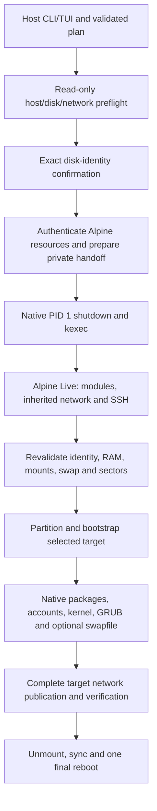

# Rustaller architecture

Rustaller is a GPL-3.0-only Linux x86_64 reinstallation tool derived from
bin456789/reinstall at `98f1e21013233d42750cc2e7a298a0818461d686`.
It is a development preview with real disk-erasing actions. Full four-target
BIOS/UEFI acceptance is still pending; see [actual evidence](ACCEPTANCE.md) and
the [continuation guide](AGENT-HANDOFF.md).

## Responsibilities

| Module | Responsibility |
| --- | --- |
| `config`, `model`, `postinstall` | Existing typed installation options and combination validation; no filesystem mutation |
| `codec`, `plan_file`, `deployment` | Bounded private handoff; credentials, disk identity and inherited network facts |
| `host` | Read-only host discovery, official resource authentication, disk confirmation and kexec handoff; native SSH public-key preparation |
| `worker` | Alpine Live orchestration, disk/RAM revalidation, first-boot NIC repair and logs |
| `targets` | Distribution bootstrap, native package policy, accounts/SSH, installed kernel/module checks, GRUB and final target verification |
| `shared::network` | Complete pure interface/DNS/MTU rendering and target-only network publication; TCP/sysctl, modules and GAI policy |
| `shared::configure` | Hostname/timezone, target isolation, safe bounded reads, path checks, publication and offline OpenRC links |
| `shared::storage`, `swapfile` | Identity-bound layouts and optional new inactive target swapfile |
| `command`, `fsutil` | Typed argv/env/I/O, checked execution, swap protections and atomic per-file replacement |
| `tui` | Host-only installation drafts, editors and review; common CLI/model validation |
| `xtask` | Checks, matching static bundle, preview release packaging, source audit and isolated VM harness |

There is one primary crate plus `xtask`; `tests/verify` is the separate retained
Shell verifier. No current-system configuration callback or administration mode
exists. DMITBox Local informed the [configuration review](DMITBOX-REVIEW.md);
its standalone implementation is historical, not a runtime dependency.

## Installation flow

Failures retain the Live rescue environment and never request the final reboot.
The automatic path requires kexec; it does not silently fall back to a two-reboot
GRUB workflow. Source PID 1 must be systemd or openrc-init. Rust manual
ISO/netboot.xyz/reset execution remains unconnected.

## Network configuration ownership

Previously `targets::install::write_network` generated interface files,
`shared::dns` reparsed them to add DNS policy, and `shared::network` parsed them
again for MTU. Final resolver setup was another target-installation writer.

Now `InstallPlan.system` and `DeploymentManifest.network` feed one pure renderer
in `shared::network`. It generates final native ifupdown/dhcpcd/udhcpc files for
Alpine or MAC-matched systemd-networkd files for Debian/Arch/Gentoo. DNS overrides,
RA/DHCPv6, static addresses, on-link gateways and MTU are rendered together.
Dynamic address/gateway snapshots are left to native DHCP/RA renewal. Systemd
DHCPv6 without RA uses `WithoutRA=solicit`; disabling IPv6 also suppresses its
addresses/routes and link-local configuration.

Installed-kernel capability and module payload checks precede publication.
`shared::configure` checks every output before writes. Module and glibc GAI
managed blocks preserve unrelated contents and reject ambiguous/foreign policy.
Package operations retain bootstrap DNS until the final network publication:
static DNS replaces it with a regular resolver; automatic systemd DNS uses the
native resolved link. Unknown resolver owners/symlinks fail explicitly.

Each file is replaced through `fsutil` and read back. Directory sync follows
rename; a multi-file change is not a transaction. The caller exclusively owns
the isolated target. A failure can leave earlier files published; it prevents
the final reboot. Offline file/kernel checks do not establish runtime sysctl
activation, DNS reachability or successful first boot.

## Preserved boundaries

- Linux x86_64 source and targets only. Alpine latest stable, Debian stable
  minbase with debootstrap/networkd, Arch rolling and Gentoo systemd stage3 all
  install from Alpine Live using native trusted package tools.
- RAM floors 512/512/1024/2048 MB are checked on host and before Live cleanup.
  Stable disk identity, mounts, swap, writable state and sector geometry are
  revalidated before destructive actions.
- Schema 6 and manifest schema 1 remain unchanged. Compatibility marker remains
  `RUSTALLER-CONFIG-20261112-06`; old plans and mismatched embedded workers fail.
- XFS (default) or ext4 root, GRUB for BIOS/64-bit EFI, Secure Boot disabled,
  512 MiB FAT32 ESP, removable/no-nvram EFI fallback. No EFI Stub.
- Optional `/swapfile` is new, fully allocated and 0600. Only target boot activates
  it; no original-host/Live swapon/swapoff or swap partition is permitted.
- Non-root installations require a separate private root password and keep root
  SSH disabled. Hostname is captured on the host, falling back to the target name.
- CachyOS remains opt-in Arch policy with pinned official setup, authenticated
  packages and a dedicated first-target-boot upgrade; no general hook mechanism.
- TUI dependencies are host-only. Worker builds use `--no-default-features`.
  `xtask bundle` verifies static ELF, version and exact worker embedding;
  `xtask dist` rejects dirty source by default and stays draft/prerelease with
  `installer_complete=false`. `sha2` remains required for release integrity.

## Retained Shell baseline

Rust automatic installation does not call the retained Shell installer.
`reinstall.sh`, `trans.sh`, `initrd-network.sh`, `fix-eth-name.sh` and their fixed
upstream comparison object remain unchanged. Shell deployment still uses exactly
four runtime assets: `trans.sh`, `initrd-network.sh`, `fix-eth-name.sh`,
`logviewer.html`, with marker `PERSONAL-LINUX-ONLY-20261119-04`. Those resources
must come from the user's matching HTTPS deployment; do not mix Rust/Shell
resource or confirmation models.
