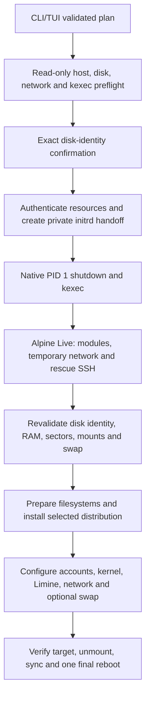

# Architecture

Rustaller is a Linux x86_64 reinstallation tool. One Rust workspace contains the
primary crate and `xtask`. The `rustaller` host executable embeds the exact
matching `rustaller-worker`; the optional `tui` feature belongs to the host.
There is no current-system administration mode or separate recovery executable.

```text
src/
├── bin/                 host CLI/TUI and internal worker entry points
├── model.rs, config.rs  typed InstallPlan and target configuration policy
├── postinstall.rs       kernel, hostname and timezone validation
├── codec.rs, plan_file.rs, deployment.rs
│                        bounded private plan, disk identity and network facts
├── command.rs, fsutil.rs typed native commands and safe per-file replacement
├── host/                preflight, sources, disk/network discovery and kexec
├── worker/              Alpine Live execution, temporary networking and first boot
├── targets/             Alpine/Debian/Arch/Gentoo packages, kernels and Limine
├── shared/              target storage, configuration, networking and swapfile
└── tui/                 installation drafts, editing and review
xtask/src/               checks, bundle, preview release, source audit and VM harness
tests/                   isolated Rust integration tests and fixtures
upstream/install.sh      passive reference; never executed or shipped
```

## Lifecycle



`host` observes the original machine and prepares the handoff; it does not
partition its disks directly. Source PID 1 must be systemd or openrc-init.
Automatic network policy capture currently requires an active, explicit flat
systemd-networkd profile; other source network managers are refused. The OpenRC
shutdown adapter remains tested in isolation, but does not by itself make OpenRC
source networking supported. Kexec is required; failure does not select a
different reboot workflow.
`worker` admits only the private Alpine Live environment and binds the selected
disk to its stable recorded identity before destructive actions. The target is
mounted separately, normally at `/os`.

`targets` owns native distribution bootstrap, package trust, accounts, kernel
payloads, initramfs and Limine. Debian uses debootstrap minbase and systemd;
Alpine uses OpenRC; Arch and Gentoo use systemd. Limine 9.6.5 is the only installed target bootloader. FAT32 is mounted at `/efi`,
while native `/boot` stays on the root filesystem. BIOS normally uses MBR with
FAT32 + root; UEFI uses GPT with ESP + root. BIOS disks at least 2 TiB use GPT
with a dedicated stage2 partition followed by FAT32 + root. Root can be XFS,
ext4 or Btrfs (`@`, optional zstd).

`shared/storage.rs` owns explicit numbered partition roles and pure layout/fstab
rendering. `targets/limine.rs` authenticates a pinned native utility and boot
payloads before disk erasure, installs BIOS stage2 or UEFI fallback, and publishes
kernel/initramfs generations on FAT32. Native package hooks invoke the same Rust
worker to refresh boot artifacts. No additional executable crate or bootloader
selection layer exists.

`host/inspect.rs` builds the CLI/TUI current-versus-target report after preflight.
The TUI renders cached facts, planned values and explicit unknowns without probing
inside its render loop. Host firmware is authoritative; forced mode is an
assertion and cannot switch it.

## Configuration boundaries

`InstallPlan` holds credentials and typed `SystemConfig`/`PostInstallConfig`.
`DeploymentManifest` separately records disk identity and validated source
network facts. Handoff encoding is bounded and rejects incompatible versions.

- `host/network.rs`: observe source addresses, applied policy and supported routing;
  `host/handoff.rs` retains authenticated installation preparation and kexec.
- `worker/initrd_network.rs`: restore connectivity in temporary Alpine Live.
- `shared/network.rs`: pure final target rendering, kernel prerequisites, and
  publication of native interface/DNS/MTU/TCP/module/GAI configuration.
- `shared/configure.rs`: target isolation, safe bounded reads, complete output
  validation, publication, hostname/timezone and offline service links.
- `fsutil.rs`: exclusive temporary files, sync, rename and failure cleanup.

Package operations use bootstrap DNS. Final network publication happens after
those operations. Replacements are atomic per file, not across the batch;
installation failure retains Live and prevents the final reboot.

## First boot and limitations

Alpine's generated ifupdown configuration uses interface names, so a one-shot
Rust worker repairs them from captured MAC addresses before networking starts.
Systemd target files match MAC addresses directly and need no filename repair.
Opt-in Arch CachyOS has a separate native first-boot full upgrade and
initramfs/Limine refresh; failure retains its pending marker for retry.

Reset infrastructure is retained; its unconnected execution remains unavailable
and hidden in the TUI. TUI routes are typed, with separate plan,
read-only preflight, native confirmation and execution stages. `tui/draft.rs`
owns shared snapshots and copy-on-write field values.

Unsupported source
network managers, complex routing, containers, ARM/Windows, Secure Boot and
provider-controlled boot contracts are not assumed compatible. See
[installation](INSTALLATION.md), [configuration](CONFIGURATION.md),
[security](SECURITY.md), [testing](TESTING.md) and [development](DEVELOPMENT.md).
