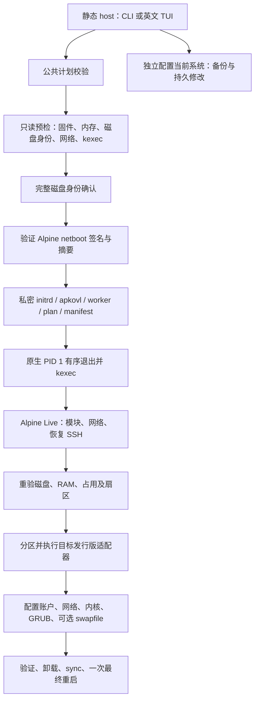

# 项目架构

项目是 bin456789/reinstall 的个人 Linux x86_64 衍生版，保留 GPLv3。当前为有真实清盘能力的开发预览，完整安装验收未完成。新 agent 先读 [续接指南](AGENT-HANDOFF.md)，运行证据以 [ACCEPTANCE.md](ACCEPTANCE.md) 为准。

## 目录与职责

```text
rustaller/
├── Cargo.toml / Cargo.lock / rust-toolchain.toml
├── build.rs                  嵌入构建器提供的匹配 worker
├── src/
│   ├── lib.rs                核心入口，集中声明 host/worker/shared/targets 子模块
│   ├── bin/rustaller.rs      CLI/TUI 入口、检查、确认与执行
│   ├── bin/rustaller-worker.rs
│   │                         无界面 Live、网络、首启与日志命令
│   ├── model.rs / config.rs / postinstall.rs
│   │                         安装计划及配置模型；不直接执行安装
│   ├── codec.rs / plan_file.rs / deployment.rs
│   │                         有界编码、私密计划文件、磁盘/网络部署清单
│   ├── command.rs / fsutil.rs
│   │                         子进程、mock、swap 防护、公共 Live 命令默认值、原子写入
│   ├── host/                 args、preflight、disk、sources、handoff、
│   │                         initrd、boot、iso、current、ssh_keygen
│   ├── worker/               args、live、install、initrd_network、firstboot、log_stream
│   ├── targets/              packages 包策略；install 公共安装；debian / rolling 适配
│   ├── shared/               storage、configure、dns、network、swapfile
│   └── tui/                  host 专属目录状态、字段、编辑、渲染与测试
├── xtask/src/                check、bundle、dist、sources、vm、vm_guest
├── tests/                    Rust 隔离测试；verify/ 为单独 Shell 对拍 crate
├── .github/workflows/        检查与预览 Release 草稿
└── docs/                     当前接口、架构、验收、续接与历史说明
```

模块按职责划分，公开路径保持稳定；TUI 的 mod.rs 含界面逻辑。

## 运行流程



Alpine 最新稳定版、Debian stable/minbase、Arch rolling、Gentoo systemd stage3 均从 Alpine Live 安装，依赖发行版原生工具。CLI/TUI 共用模型和回调，按目标保存草稿；ssh-keygen 暂时恢复终端，仅公钥进入计划。当前系统配置独立于清盘，见 [CONFIGURATION.md](CONFIGURATION.md)。

## 模块边界

| 层 | 负责 | 不负责 |
|---|---|---|
| model/config/postinstall | 计划、字段及组合约束 | 文件修改、下载、执行安装 |
| host | 发现、认证资源、身份确认、交接、当前系统配置 | 在原系统直接格式化目标盘 |
| worker | Live 入口与阶段顺序、首启服务 | TUI、再次询问主机安装选项 |
| targets | 各发行版 rootfs、包、内核、GRUB、验证 | UI、任意用户脚本钩子 |
| shared | 受检目标目录中的配置及存储操作 | 授权选择目标盘 |
| command | 明确 argv/env/I/O、并发捕获、mock、swap 限制 | 解释并执行自由输入的 Shell |
| xtask | 开发检查、静态打包、源审计、隔离 VM | 随运行时部署 |

Live 命令默认 cwd=/、stdin=null、输出继承；适配器保留各自环境及错误/重试语义。

## 相似代码的归并（2026-11-12）

此次重构通过 278 项 workspace、49 项 Shell 测试及格式/lint/语法检查，静态 bundle、worker 精确嵌入与两个入口的 --help 检查通过；无新增 BIOS/UEFI 完整安装证据。

| 公共入口 | 合并的职责 | 调用方继续负责 |
|---|---|---|
| command::checked_output | 启动命令、要求退出码为零、构造统一命令错误 | 阶段名、argv、环境、工作目录及 I/O 策略 |
| command::run_checked / capture_checked | 分别执行并检查、捕获 stdout 并检查；复用同一状态检查 | UTF-8 解码、领域错误及输出长度限制 |
| command::target_command | 两套目标适配器共同的 Live 默认值、PATH 和 SYSTEMD_OFFLINE | install 的 LC_ALL/DEBIAN_FRONTEND；rolling 的 LANG/TERM |
| shared::dns::write_config | 检查目标路径、准备父目录、按指定权限原子写入 | 目标 root 的隔离校验、配置内容、目标发行版和权限选择 |
| shared::dns::walk_parents | 检查每级祖先是否为真实目录；按入口决定是否创建缺失目录 | validate_planned_parent 保持只检查，ensure_parent 允许创建 |

host/handoff、worker/install、targets/install、targets/rolling、shared/swapfile 共用 capture_checked；输出上限、解码错误和 stderr 策略留在调用方。worker/install 复用 live_command 并保留 LC_ALL=C。

目标写入复用 dns 路径检查，不新增跨层模块；批量 DNS/网络仍先校验整批再发布，保持失败前的修改范围。

保留语义不同的实现：三种 UUID 校验、Gentoo 元数据解析与签名认证、Debian/公共 fstab 的注释/ESP/fsck 差异。磁盘、内存、挂载复验属于安全检查，不作为重复代码删除。

## 作用原理与阅读顺序

1. bin/rustaller.rs：CLI/TUI 共用 InstallPlan 与回调；model/config/postinstall 定义配置，codec/plan_file 负责交接与私密文件生命周期。
2. host/handoff.rs：discover 收集原系统事实和磁盘令牌，prepare 认证资源/组装 Live，execute 复验后由 PID 1 有序退出并 kexec，不经过固件重启。
3. bin/rustaller-worker.rs、worker/install.rs：验证 Live 来源、恢复网络/SSH，以 manifest 稳定身份重绑磁盘，复验 RAM/挂载/swap/扇区后分区。Live 根在内存，目标挂载于 /os。
4. targets/install.rs、debian/rolling/packages：串联 prepare/bootstrap/configure/最终验证，以原生 APK、APT、pacman、Portage 实现发行版差异；Rust 控制参数与顺序。
5. shared：storage 布局/格式化/挂载，其余模块配置受检目标。验证成功、卸载、sync 后才最终重启，失败保留 Live 恢复环境。
6. host/current.rs：独立备份/发布当前系统配置；TUI 负责草稿和展示。xtask、测试、Shell 对拍为开发工具，Rust 自动入口不调用保留 Shell 实现。

## 不可破坏的约束

- 核心无第三方运行时依赖；ratatui/crossterm 仅 host 可选 tui feature。worker 用 --no-default-features。
- 计划 schema=5；部署清单 schema=1；兼容标记 PERSONAL-LINUX-XFS-20261102-05。改变交接协议必须同步校验与测试。
- Alpine netboot 与 Gentoo stage3 有固定发布密钥/签名/摘要验证；APT/APK/pacman 使用原生信任链。audit-sources 只检查元数据和可达性。
- 清盘以稳定磁盘身份为依据，Live 重绑后再验挂载、swap、RAM 和只读/扇区状态。
- UEFI 要求 64 位固件与未启用 Secure Boot；512 MiB FAT32 ESP；GRUB 使用 removable/no-nvram。平台限制见验收文档。
- 原系统和 Live 不执行 swapon/swapoff；可选新目标 XFS /swapfile 仅在目标启动后激活。
- 失败不请求最终重启；不能自动退回两次重启。当前只适配 systemd/openrc-init 原系统 PID 1。

## 构建与分发

`cargo xtask bundle` 验证无 TUI worker 的静态 ELF/版本，再嵌入 host 并核对精确字节。`cargo xtask dist` 默认拒绝脏源码，Release 保持 draft/prerelease、`installer_complete=false`；CI 获取固定上游对拍对象。见[发布指南](GITHUB-RELEASE.md)。

## 保留的 Shell 基线

Shell 兼容标记仍为 PERSONAL-LINUX-ONLY-20261119-04；Rust 的新标记和 schema 不用于这些保留资源。

`reinstall.sh` 准备原系统，`trans.sh` 执行 Live 安装；保留作对拍及未迁移接口，验收前不能删除，也不能混用 Rust/Shell 的确认与资源模型。

Shell 部署除 reinstall.sh 外仍恰好四个资源：trans.sh、initrd-network.sh、fix-eth-name.sh、logviewer.html。TTY/frpc helpers 和服务模板已内联；资源必须来自用户控制的匹配 HTTPS 部署。Rust 内嵌 worker 与日志页面，不套用这条四文件部署规则。

Rust 手动 ISO/netboot.xyz/reset 目前有菜单/模型/部分组件，实际交接未连接。保留代码不等于功能已交付；完整待办见续接指南。
